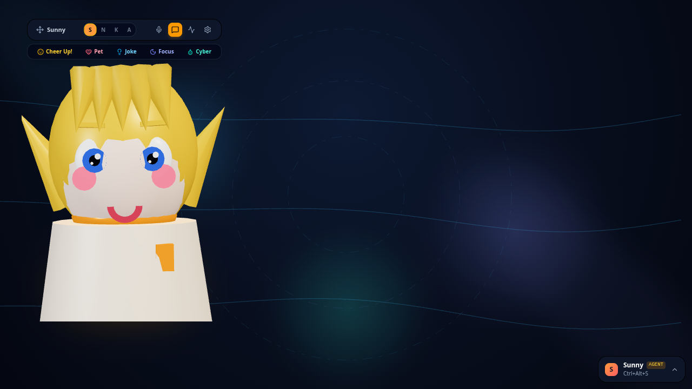
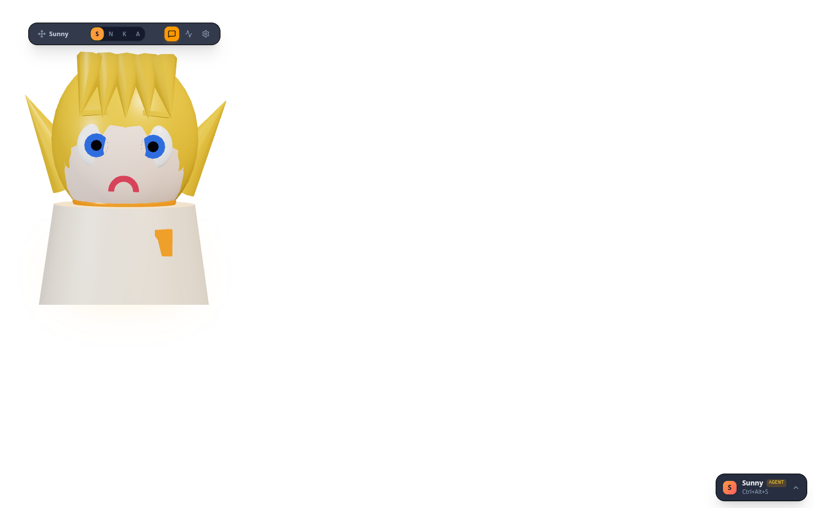
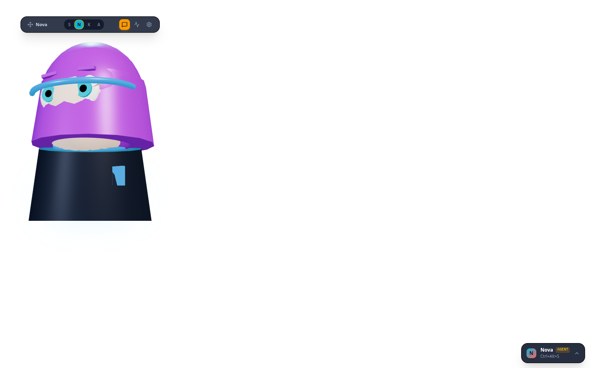
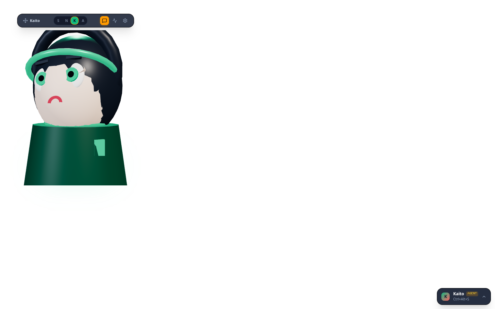
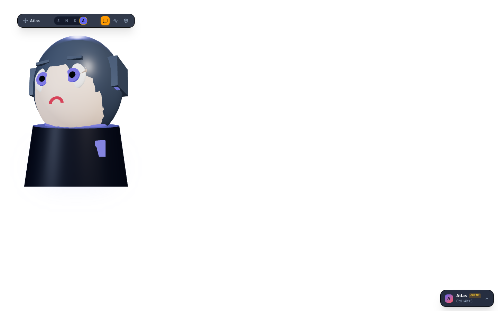
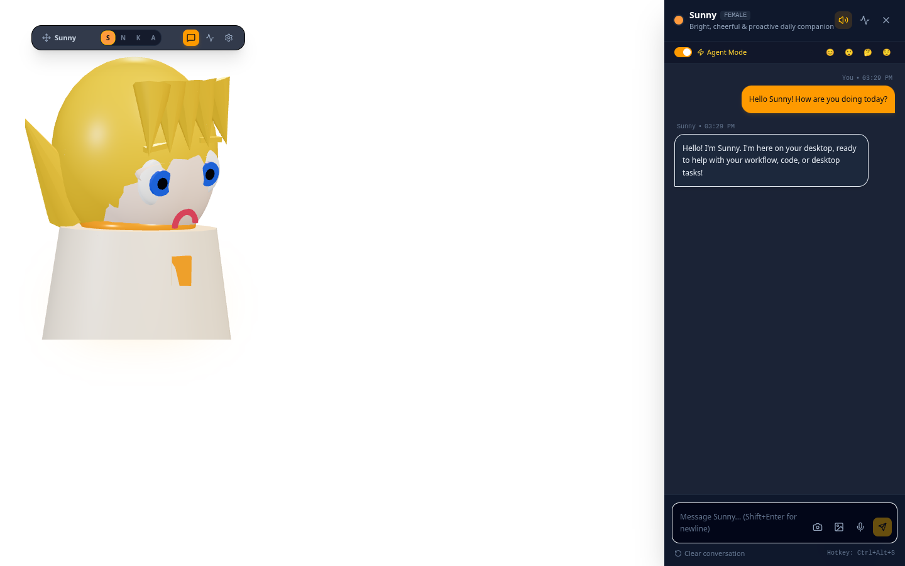
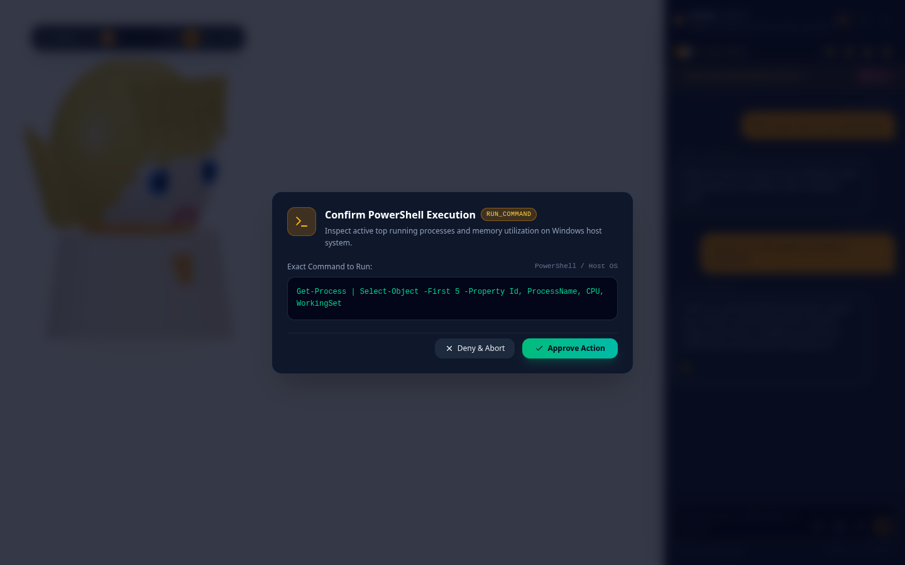
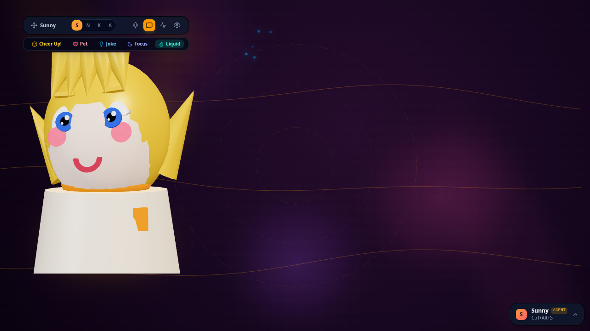
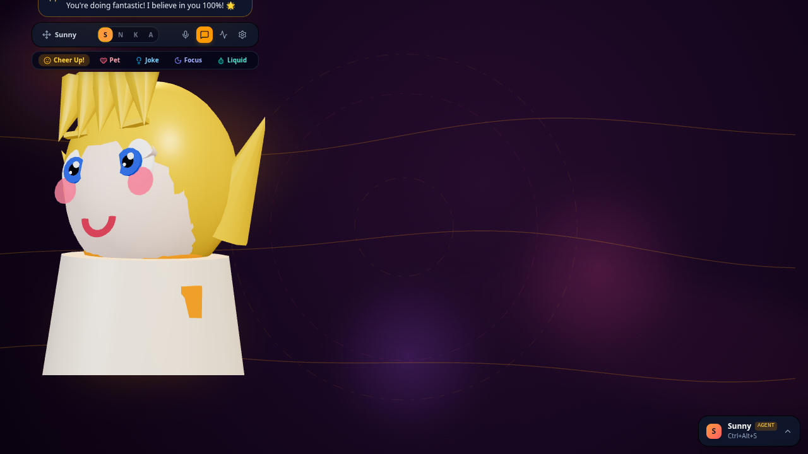

# ☀️ Sunny — 3D AI Desktop Companion & Autonomous Agent

<div align="center">

-0078D6?style=for-the-badge&logo=windows&logoColor=white)


**A high-performance 3D AI desktop companion and autonomous agent for Windows powered by Google Gemini.**  
*Floating transparent viewport • Eye-tracking anime avatars • Real-time lip-sync • Safe PowerShell automation • Dynamic liquid UI caustics*

[Download Windows .exe](https://github.com/paskantigovardhan123/sunny-desktop-ai/releases) • [Features](#-key-features) • [4 Companions](#-meet-the-4-companion-agents) • [Safety System](#-strict-security--safety-blocklist) • [Quick Start](#-quick-start-guide)

</div>

---

## 📸 Screenshots & Showcase

<div align="center">

### ☀️ Sunny in Liquid Cyber Aurora Desktop Environment


*Floating transparent companion pod with real-time cursor-reactive liquid caustics, audio wave pulses, and animated 3D procedural anime expressions.*

</div>

---

## ✨ Key Features

- **🪟 Borderless Transparent 3D Avatar Window**:
  - Always-on-top, draggable, click-through capable, and non-intrusive on your workspace.
  - Procedural 3D anime avatars with procedural eye-tracking cursor look-at, randomized natural eye blinking, rosy cheek blush discs (`#FF6584`), and sparkling double eye catchlights.
  - Real-time speech lip-sync visemes (`aa`, `ih`, `oh`) synchronized with character voices.
- **🔐 Privacy & Hardware-Encrypted Storage**:
  - Secure first-launch setup wizard requiring your personal Google Gemini API key.
  - Real-time key authentication against Google Gemini before saving.
  - Hardware encryption via **Electron `safeStorage`** (Windows DPAPI / AES-GCM). API keys are never shared, logged, or stored in plaintext.
- **💬 Conversational Chat & Multimodal Desktop Vision**:
  - Global hotkey (`Ctrl + Alt + S`) to summon the slide-out chat drawer from anywhere in Windows.
  - Push-to-Talk voice recognition (STT) and character-specific voice synthesis (TTS).
  - One-click desktop screen capture and image attachment for visual analysis.
- **⚡ Autonomous Agent Mode with Strict Safety Rules**:
  - Built-in host tools: PowerShell execution (`run_command`), file read/write, directory listing, web search, desktop screenshot capture, and reminders.
  - **Mandatory User Confirmation**: Every command execution or file modification requires an explicit **Approve** or **Deny** click with exact command preview and safety rationale.
  - **Non-Bypassable Hard-Block Rule**: Formatting drives (`format`), recursive root deletion (`rm -rf /`, `Remove-Item C:\`), registry tampering, and disabling Windows Defender are permanently blocked at the engine AST level.
- **🌊 Interactive Liquid Background with Dynamic Cooling Effects**:
  - Replaces flat boring white screens with interactive ambient caustics, floating metaballs, and cursor cooling ripples.
  - 5 selectable theme presets: *Cyber Aurora*, *Deep Ocean Glass*, *Liquid Cyber Sunset*, *Dark Obsidian*, and *Transparent Desktop*.

---

## 👥 Meet the 4 Companion Agents

Sunny bundles 4 distinct 3D avatars with custom voice pitches, individual system prompts, and isolated conversation memories:

| Companion | Preview & Personality | Voice & Specialty |
|---|---|---|
| **☀️ Sunny**<br>*(Default)* |  | **Voice**: 1.25x Cheerful Soprano<br>**Role**: Daily companion, positivity booster, routine organizer, and enthusiastic helper. |
| **🌐 Nova** |  | **Voice**: 1.05x Crisp Technologist<br>**Role**: Cyber researcher, systems analyst, code debugger, and architecture specialist with glowing cybernetic visor. |
| **🌿 Kaito** |  | **Voice**: 0.90x Calm Tenor<br>**Role**: Strategic thinker, creative mentor, and tranquil philosopher with emerald headband. |
| **⚡ Atlas** |  | **Voice**: 0.80x Tactical Baritone<br>**Role**: Tactical executive assistant, system operator, and direct task executor. |

---

## 💬 Conversational Chat & Desktop Vision

The slide-out chat drawer provides real-time streaming replies powered by Google Gemini, screen capture tools, and companion controls.

<div align="center">



</div>

---

## 🛡️ Strict Security & Safety Blocklist

When Agent Mode is active, Sunny can interact with Windows host tools. To ensure 100% safety, every operation passes through a 2-tier security subsystem:

### 1. Mandatory Approval Dialog
Before executing any PowerShell command or writing files, Sunny presents an explicit approval modal detailing the exact command and why it is needed:

<div align="center">



</div>

### 2. Hard-Blocked Operations
Even if a user tries to approve a destructive prompt, Sunny's engine AST blocklist permanently aborts the execution:

| Category | Blocked Command Patterns | Rationale |
|---|---|---|
| **Drive Formatting** | `format C:`, `format /fs`, `diskpart clean`, `mkfs` | Prevents disk wipe |
| **Root Deletion** | `rm -rf /`, `Remove-Item -Recurse C:\*`, `del /s /q C:\` | Protects filesystem root |
| **Registry Tampering** | `reg delete HKLM\...`, `Remove-ItemProperty HKLM:...` | Prevents OS instability |
| **Disabling Antivirus** | `DisableRealtimeMonitoring`, `net stop WinDefend`, `netsh advfirewall off` | Prevents security bypass |
| **System Root Writes** | `C:\Windows\System32\...`, `/etc/...` | Protects OS integrity |

---

## 🎨 Wonderful Liquid UI Themes

Switch visual aesthetics with one click on the companion pod or via Settings:

| Cyber Aurora (Default) | Liquid Cyber Sunset |
|:---:|:---:|
|  |  |

| Push-to-Talk Soundwave | Companion Encouragement Bubble |
|:---:|:---:|
|  |  |

---

## 🚀 Quick Start Guide

### For End Users (Windows .exe)
1. Go to **[Releases](https://github.com/paskantigovardhan123/sunny-desktop-ai/releases)**.
2. Download **`Sunny-Setup.exe`** (or `Sunny-Setup.zip`).
3. Run `Sunny-Setup.exe` on Windows 10 or 11 (no admin privileges needed).
4. Enter your free API key from [Google AI Studio](https://aistudio.google.com/app/apikey) on first launch.
5. Sunny appears on your desktop!

---

### For Developers (Clone & Run Locally)

```bash
# 1. Clone repository
git clone https://github.com/<YOUR_GITHUB_USERNAME>/sunny-desktop-ai.git
cd sunny-desktop-ai

# 2. Install dependencies
npm install

# 3. Start local development server (port 3000)
npm run dev

# 4. Run safety unit tests
npm test

# 5. Build standalone Windows .exe
npm run build:electron
